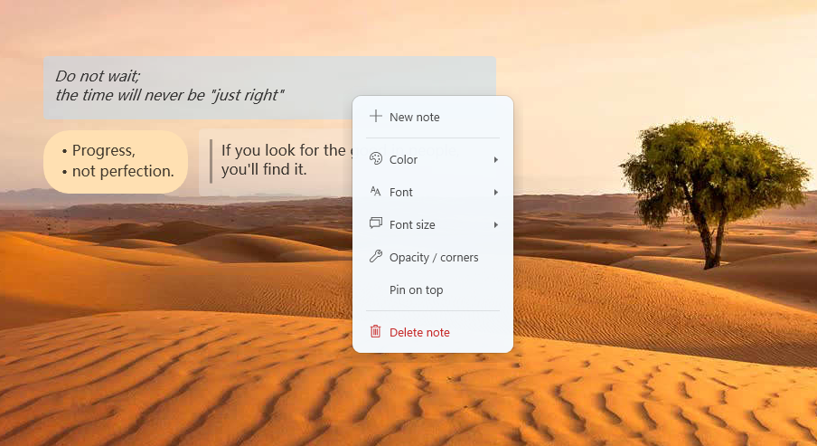

# VSticky

[English](README.md) | [简体中文](README.zh-CN.md)

Lightweight sticky notes for Windows. Multiple notes, translucent rounded windows, Markdown preview, system tray, global hotkeys, and snap-to-align.

> Inspired by tools like ATnotes. Intentionally simple: no accounts, no cloud sync.

## Screenshots

| Desktop notes | Tray menu |
|:---:|:---:|
|  |  |

## Features

- **Multiple notes**: Borderless, resizable; opacity / corners / color / font adjustable; optional always-on-top
- **Editing**: Drag in preview mode; double-click to edit; blur or `Esc` to exit; common Markdown via Markdig
- **Snap when near**: Align to other notes while dragging (edges / centers / gap); toggle in tray; hold `Shift` to disable temporarily
- **System tray**: Left-click to create; right-click menu (language, start with Windows, hotkeys, snap, exit)
- **Global hotkey**: `Ctrl+Win+Alt+N` to create a note (toggle under Hotkeys)
- **Start with Windows**: Tray checkbox writes the current-user Run key
- **i18n**: Built-in Simplified Chinese / English; extend via `Locales/*.json`
- **Persistence**: Notes and settings under `%AppData%\VSticky\`
- **Hidden from Alt+Tab**: Notes stay off the taskbar and switcher list

## Requirements

- Windows 10 / 11
- [.NET 8 SDK](https://dotnet.microsoft.com/download/dotnet/8.0) to build from source
- [.NET 8 Desktop Runtime](https://dotnet.microsoft.com/download/dotnet/8.0) if you run a framework-dependent publish

## Run from source

```bash
git clone https://github.com/Victhy/VStickyNote.git
cd VStickyNote
dotnet run -c Release
```

Or build then launch:

```bash
dotnet build -c Release
.\bin\Release\net8.0-windows\VSticky.exe
```

## Publish binaries (optional)

Framework-dependent (smaller; requires Desktop Runtime):

```bash
dotnet publish -c Release -r win-x64 --self-contained false -o .\publish
```

Self-contained (larger; run after unzip):

```bash
dotnet publish -c Release -r win-x64 --self-contained true -o .\publish
```

## Data locations

| Path | Purpose |
|------|---------|
| `%AppData%\VSticky\notes.json` | All notes (including soft-deleted) |
| `%AppData%\VSticky\settings.json` | Defaults and toggles (language, autostart, hotkeys, snap, …) |
| `%AppData%\VSticky\Locales\` | Optional user locale packs |

Built-in strings live in `Locales\zh-CN.json` and `Locales\en-US.json` next to the app.

## Shortcuts & gestures

| Action | Behavior |
|--------|----------|
| Drag a note | Move in preview mode; snap when near other notes |
| Double-click | Enter edit mode |
| `Esc` / lose focus | Exit edit and render Markdown |
| Right-click a note | New, color, font, size, appearance, pin, delete |
| Tray left-click | New note |
| Tray right-click | Language, autostart, hotkeys, snap, exit |
| `Ctrl+Win+Alt+N` | Global new note (must be enabled in tray) |

## Tech stack

- .NET 8 · WPF (`UseWindowsForms` only for the tray icon)
- [Markdig](https://github.com/xoofx/markdig)

## License

[MIT](LICENSE)

## Acknowledgments

Inspired by desktop sticky-note apps such as ATnotes.
