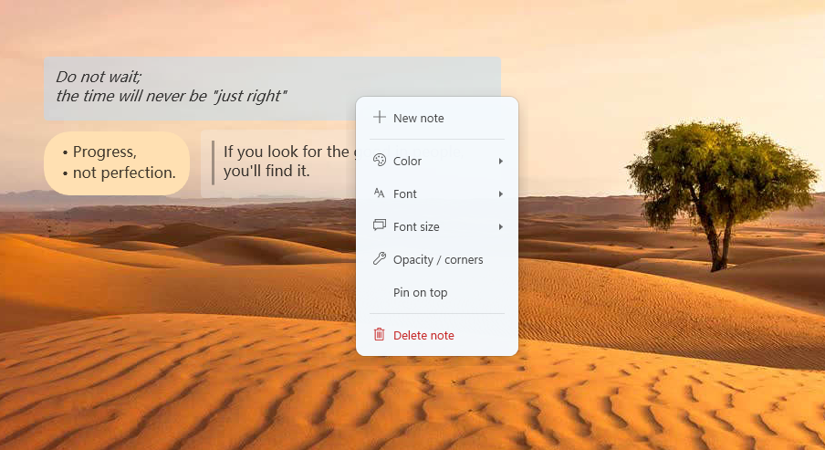

# VSticky

[English](README.md) | [简体中文](README.zh-CN.md)

轻量 Windows 桌面便签。多开、半透明圆角、Markdown 预览、系统托盘、全局热键与靠近吸附。

## 截图

| 桌面便签 | 托盘菜单 |
|:---:|:---:|
|  |  |

## 功能

- **多便签窗口**：无边框、可拖动缩放；透明度 / 圆角 / 颜色 / 字体可调；可置顶
- **编辑体验**：预览态拖动；双击编辑；失焦或 `Esc` 退出；常用 Markdown（Markdig）
- **靠近吸附**：拖动靠近其他便签时自动对齐（边缘 / 中心 / 间距）；托盘可开关；按住 `Shift` 临时禁用
- **系统托盘**：左键新建；右键菜单（语言、开机启动、热键管理、靠近吸附、退出）
- **全局热键**：`Ctrl+Win+Alt+N` 新建便签（可在「热键管理」中开关）
- **开机启动**：托盘勾选后写入当前用户 Run 项
- **多语言**：内置简体中文 / English；可扩展 `Locales/*.json`
- **持久化**：便签与设置保存在 `%AppData%\VSticky\`
- **Alt+Tab 隐藏**：便签不进任务栏与切换列表

## 环境要求

- Windows 10 / 11
- [.NET 8 SDK](https://dotnet.microsoft.com/download/dotnet/8.0)（自行编译）
- 运行已发布包时，需安装 [.NET 8 Desktop Runtime](https://dotnet.microsoft.com/download/dotnet/8.0)（若使用依赖框架的发布方式）

## 从源码运行

```bash
git clone https://github.com/Victhy/VStickyNote.git
cd VStickyNote
dotnet run -c Release
```

或编译后启动：

```bash
dotnet build -c Release
.\bin\Release\net8.0-windows\VSticky.exe
```

## 发布可执行文件（可选）

依赖框架（体积小，需本机已装 Desktop Runtime）：

```bash
dotnet publish -c Release -r win-x64 --self-contained false -o .\publish
```

自包含（体积大，可直接解压运行）：

```bash
dotnet publish -c Release -r win-x64 --self-contained true -o .\publish
```

## 数据位置

| 文件 | 说明 |
|------|------|
| `%AppData%\VSticky\notes.json` | 全部便签（含软删除） |
| `%AppData%\VSticky\settings.json` | 全局默认与开关（语言、开机启动、热键、吸附等） |
| `%AppData%\VSticky\Locales\` | 可选：用户自定义语言包 |

程序目录下的 `Locales\zh-CN.json`、`en-US.json` 为内置文案。

## 主要操作

| 操作 | 说明 |
|------|------|
| 拖动便签 | 预览态按住拖动；靠近其他便签可吸附 |
| 双击 | 进入编辑 |
| `Esc` / 失焦 | 退出编辑并渲染 Markdown |
| 右键便签 | 新建、颜色、字体、字号、外观、置顶、删除 |
| 托盘左键 | 新建便签 |
| 托盘右键 | 语言、开机启动、热键、吸附、退出 |
| `Ctrl+Win+Alt+N` | 全局新建（需在托盘启用） |

## 技术栈

- .NET 8 · WPF（`UseWindowsForms` 仅用于托盘图标）
- [Markdig](https://github.com/xoofx/markdig)

## 许可证

[MIT](LICENSE)

## 致谢

灵感来自桌面便签类工具（如 ATnotes）。
